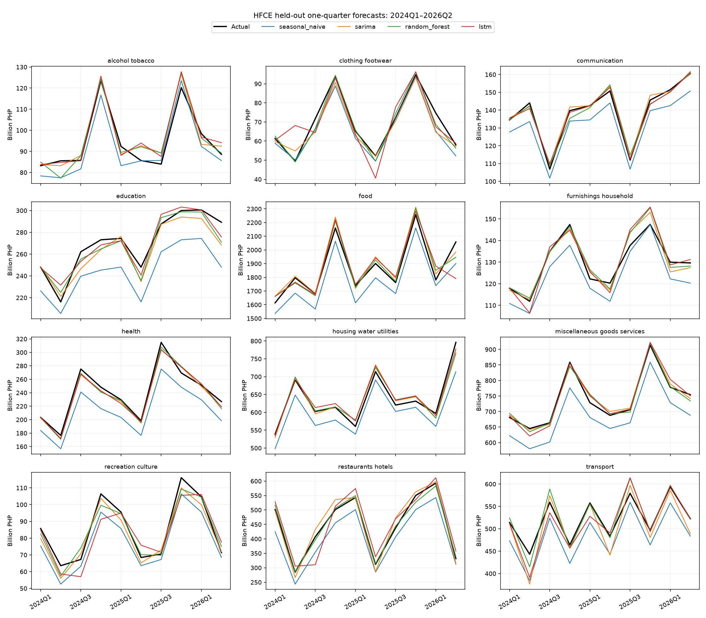

# HFCE Pooled LSTM and Random Forest Experiment

Run: 2026-10-20T15:46:57.397295+00:00. Seed: 42 (single seed).

## Split and validation

| Partition | Period | Quarters/category | Observations (12 categories) |
| :--- | :--- | ---: | ---: |
| Initial train | 2000Q1–2016Q4 | 68 | 816 |
| Validation | 2017Q1–2023Q4 | 28 | 336 |
| Test | 2024Q1–2026Q2 | 10 | 120 |

Validation has 28 expanding origins; test has 10. Each origin forecasts up to four quarters, truncated at its partition boundary. All categories share the same cutoff. Scalers and models refit from scratch using only observations before that origin. Test observations enter training only after they become available in chronological order. No model settings change after validation selection.

Four configurations per pooled family are ranked by macro category SMAPE across validation origins/horizons. Monetary MAE is reported separately because category scales differ. The first 12 or 16 quarters are feature context, yielding 672 or 624 labeled initial training windows, respectively; windows overlap and are not independent observations.

## Models and seasonal representation

One RF or LSTM pools all 12 categories. Each input contains category identity, relative log levels, QoQ/YoY growth, observed quarter and target quarter sin/cos features. The target is log year-over-year growth. Reconstruction multiplies the same-quarter prior-year level by predicted growth; multi-quarter predictions are recursive. Thus these are explicitly seasonal models, not raw-level RF/LSTM baselines. The seasonal lag permits RF forecasts to grow with the latest observed levels.

LSTM uses one recurrent layer, full-batch Adam (learning rate 0.01, weight decay 0.001), gradient clipping 1.0, fixed epochs, CPU and one thread. Both pooled families use training-only input and target standardization. No early stopping, future covariates, interpolation, or COVID intervention is used.

SARIMA uses the original per-category validation-selected specifications from the existing evaluation file, with 300 optimizer iterations. It does not use test-dependent release substitutions. Finite nonconverged fits remain in evaluation and are counted explicitly; no test-based model replacement occurs. This is a controlled refit comparison, not an exact reproduction of released SARIMA metrics. The original SARIMA search ranked per-category monetary MAE; the pooled search ranks macro SMAPE. Search budgets and seasonal representations also differ, so this compares practical forecasting setups rather than isolating architecture alone.

## Selected pooled configurations

```json
{
  "random_forest": {
    "family": "random_forest",
    "window": 8,
    "min_samples_leaf": 5,
    "trees": 200
  },
  "lstm": {
    "family": "lstm",
    "window": 8,
    "hidden_size": 16,
    "epochs": 100
  }
}
```

## Results



SMAPE is equally weighted across categories; lower is better. MDA compares the forecast and target with the last observation available at the origin. Monetary errors use million PHP. Overlapping multi-horizon forecasts are counted per origin and horizon, not as independent quarters.

| Split | Model | Horizon | Macro SMAPE (%) | Macro MDA (%) | Pooled MAE | Pooled RMSE |
| :--- | :--- | :--- | ---: | ---: | ---: | ---: |
| validation | random_forest | 1 | 6.818 | 87.50 | 11926.33 | 25488.59 |
| validation | random_forest | 4 | 11.730 | 78.33 | 22244.36 | 42765.64 |
| validation | random_forest | 1–4 | 9.459 | 86.48 | 17371.90 | 35518.45 |
| validation | lstm | 1 | 6.324 | 88.39 | 11793.96 | 24983.35 |
| validation | lstm | 4 | 11.968 | 76.33 | 22334.63 | 44946.86 |
| validation | lstm | 1–4 | 9.366 | 85.85 | 17381.87 | 36393.43 |
| validation | seasonal_naive | 1 | 11.929 | 80.06 | 32187.93 | 50757.58 |
| validation | seasonal_naive | 4 | 12.483 | 0.00 | 33701.19 | 52781.91 |
| validation | seasonal_naive | 1–4 | 12.189 | 61.01 | 32895.26 | 51709.56 |
| validation | sarima | 1 | 5.630 | 91.37 | 10378.55 | 22848.20 |
| validation | sarima | 4 | 9.862 | 78.33 | 19681.59 | 39366.59 |
| validation | sarima | 1–4 | 7.831 | 87.89 | 15227.68 | 32188.87 |
| test | seasonal_naive | 1 | 7.492 | 82.50 | 29802.02 | 42200.49 |
| test | seasonal_naive | 4 | 7.028 | 0.00 | 29033.38 | 41622.69 |
| test | seasonal_naive | 1–4 | 7.289 | 65.93 | 29530.50 | 42091.78 |
| test | sarima | 1 | 3.082 | 97.50 | 10974.38 | 18544.55 |
| test | sarima | 4 | 4.504 | 83.33 | 18722.61 | 31214.84 |
| test | sarima | 1–4 | 3.797 | 93.14 | 14626.30 | 25179.66 |
| test | random_forest | 1 | 2.484 | 96.67 | 9338.65 | 17456.52 |
| test | random_forest | 4 | 3.000 | 95.24 | 10980.38 | 18279.32 |
| test | random_forest | 1–4 | 2.638 | 96.57 | 9677.20 | 17112.51 |
| test | lstm | 1 | 3.834 | 95.00 | 13654.71 | 31478.27 |
| test | lstm | 4 | 7.462 | 84.52 | 21374.78 | 35869.65 |
| test | lstm | 1–4 | 5.649 | 92.65 | 17467.62 | 31503.62 |

## Test category SMAPE (one quarter ahead)

| Category | Seasonal naive | SARIMA | Pooled RF | Pooled LSTM |
| :--- | ---: | ---: | ---: | ---: |
| alcohol_tobacco | 5.150 | 3.983 | 4.039 | 3.553 |
| clothing_footwear | 5.592 | 5.030 | 3.310 | 9.283 |
| communication | 5.338 | 1.105 | 1.439 | 1.147 |
| education | 10.081 | 3.042 | 2.512 | 2.503 |
| food | 5.536 | 2.124 | 2.224 | 3.345 |
| furnishings_household | 4.991 | 2.130 | 2.018 | 2.757 |
| health | 11.662 | 2.264 | 2.218 | 2.174 |
| housing_water_utilities | 5.704 | 1.977 | 1.792 | 1.697 |
| miscellaneous_goods_services | 8.079 | 1.271 | 1.452 | 1.515 |
| recreation_culture | 9.376 | 5.126 | 4.604 | 7.252 |
| restaurants_hotels | 10.435 | 4.476 | 1.881 | 7.533 |
| transport | 7.957 | 4.459 | 2.313 | 3.253 |

## Interpretation and limits

Lowest test macro SMAPE at horizon 1: `random_forest`. Lowest test macro SMAPE at horizon 4: `random_forest`. `random_forest` beats SARIMA one-step SMAPE in 8/12 categories. `lstm` beats SARIMA one-step SMAPE in 5/12 categories. SARIMA nonconverged origin/category fits in validation: 0. SARIMA nonconverged origin/category fits in test: 2. After excluding the same nonconverged SARIMA origin/category pairs from every model, one-step macro SMAPE is seasonal_naive: 7.457%; sarima: 3.113%; random_forest: 2.513%; lstm: 3.893%.

A pooled model can represent seasonal HFCE, but seasonality alone does not establish superiority over local SARIMA. Judge the held-out errors by horizon and category. The 12 categories share macroeconomic shocks and do not provide 12 independent economic histories. The 10-quarter test window, one seed, small search grid, validation-period COVID shock, and explicit seasonal growth engineering limit generalization. This experiment does not establish performance on personal household spending or on a new category.

The test period was already used by the pre-existing SARIMA experiment; it is held out from this new pooled selection, not a newly collected prospective sample. Further tuning after inspecting these results requires a new evaluation window. Full-data final refits are for future forecasts only and are never used to report test scores.

See the adjacent JSON for candidate validation scores, category/horizon metrics, SARIMA convergence counts, hashes, and dependency versions. Forecast-level CSVs, scalers, fitted models, split assignments, and four-quarter future forecasts are in the generated output directory recorded there.

## Saved models

Both selected models are refit through 2026Q2 and saved as self-contained `random_forest.joblib` and `lstm.joblib` bundles. Each includes category ordering, configuration, input/target scalers, training cutoff and data hash. The LSTM bundle embeds its learned weight arrays and architecture dimensions; no separate weights file is required.

```python
from pathlib import Path
from training.scripts.modeling.compare_hfce_global_models import load_global, forecast_global

model = load_global(Path("training/models/hfce_global_comparison/lstm.joblib"))
# history: positive quarterly HFCE DataFrame, PeriodIndex(freq='Q'),
# columns ordered exactly as model.categories; forecasts return horizon x category.
predictions = forecast_global(model, history, horizon=4)
```

## Reproduction

Run from the repository root with the existing virtual environment and local observed HFCE dataset:

```bash
.venv/bin/python training/scripts/modeling/compare_hfce_global_models.py
.venv/bin/pytest -q tests/test_compare_hfce_global_models.py tests/test_train_hfce_sarima_v4.py
```
