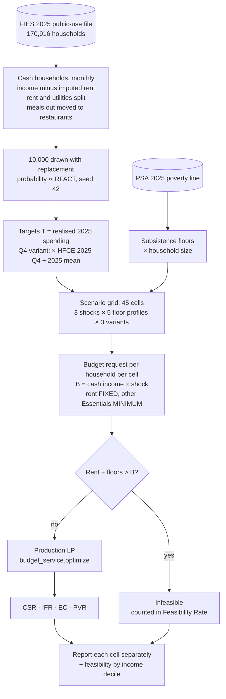

# Budget LP Evaluation Metrics

```json
{
  "document-type": "model-evaluation",
  "version": "2.0.0",
  "date": "2026.10.18",
  "authors": ["Group 4, III-DCSAD"]
}
```

The budget recommendation linear program (`app/services/budget_service.py`) is
evaluated with four metrics: Constraint Satisfaction Rate, Idle Funds Rate,
Essential Coverage, and Priority Validation Rate. The
[metrics study](evaluation-metrics-study.md) is the source of truth for their
definitions, sources, and rationale.

The evaluation tests whether the LP **plans correctly**, not whether it forecasts a
future month correctly. Every input is observed FIES 2025 data, so nothing is
projected; the forecaster is evaluated separately in the HFCE SARIMA pipeline.

Produced by `training/scripts/modeling/evaluate_budget.py`. Results are written to
`training/datasets/budget_evaluation/evaluation.json` and `plans.csv` (both
gitignored; rerun the script to regenerate them, about 20 minutes).

---

## Pipeline



---

## Evaluation Design

Every parameter is observed 2025 data or has a cited basis, except the 0–90% floor
sweep levels, which are labelled hypothetical, and the 2025 food threshold, which is
derived until PSA's figure is confirmed.

| Parameter | Value | Basis | Reference |
|---|---|---|---|
| Households | FIES 2025 public-use file (170,916 households); 10,000 drawn with replacement, probability ∝ RFACT, seed 42 | Weight-proportional resampling reproduces the weighted population. The RFACT-weighted mean TOINC is PhP 411.35k, matching PSA's published 2025 average | Mathur et al. (2024); Dong et al. (2014); PSA (2026b) |
| Monthly cash income | (TOINC − IMPUTED_RENT) ÷ 12 | TOINC includes the imputed rent of owner-occupied dwellings (8.7% of 2025 income), which is never received as cash | PSA (2024b) §IV.3; PSA (2026b) |
| Rent | ACTRENT ÷ 12, FIXED in every profile | Shelter is a consumption commitment: costly to adjust, and slower to contract than to expand | Kantak (2025); Chetty & Szeidl (2007) |
| Utilities | (HOUSING_WATER − IMPUTED_RENT − ACTRENT) ÷ 12, MINIMUM | Imputed rent is 51.8% of 2025 housing spending; utilities are adjusted more often than rent | PSA (2024b) §IV.9; Chetty & Szeidl (2007), Table I |
| Food | (FOOD − FOOD_OUTSIDE) ÷ 12 | FOOD includes food regularly consumed outside the home (17.1% of FOOD in 2025) | `RAW/uncleaned/2025/CLEANING_RULES.md` |
| Restaurants & hotels | FOOD_OUTSIDE ÷ 12 | Food-service proxy; accommodation is not separately established | `RAW/uncleaned/2025/CLEANING_RULES.md` |
| Other 8 categories | ALCOHOL + TOBACCO, CLOTH, FURNISHING, HEALTH, TRANSPORT, COMMUNICATION, RECREATION, EDUCATION, MISCELLANEOUS, each ÷ 12 | FIES 2025 purpose fields | `RAW/uncleaned/2025/CLEANING_RULES.md` |
| Target $T_i$ | The household's realised 2025 monthly spending | A perfect-forecast target, so the LP is tested independently of forecast error | — |
| Seasonal stress | Targets × HFCE 2025-Q4 ÷ 2025 quarterly mean, per purpose | Observed national Q4 peak | PSA HFCE by purpose (`training/datasets/hfce_v4/`) |
| Available funds $B$ | Cash income × shock | Observed 2025 income; no projection | — |
| Income shocks | 1.0 / 0.93 / 0.5 | 0.93: about −7% average household income after typhoons in FIES data (−6.6% originally; −6.7% rainfall plus −0.3% wind on FIES 2004–2015). 0.5: severe, pandemic-type stress case; 44.2% of affected business households lost about half their income. The worst typhoon case is −24.4%, so 0.5 is not a typhoon-scale shock | Anttila-Hughes & Hsiang (2013); Schleypen et al. (2024); World Bank (2022), q47a1 |
| Floor sweep | Essentials other than rent at MINIMUM 0 / 50 / 70 / 90% of target | 0% matches the app's default (no user minimum means FLEXIBLE). 50, 70 and 90% are hypothetical levels spanning the range to near-full minimums; they test robustness and are not estimates of user behaviour | Design: Kleijnen (2015); Tarantola et al. (2024). The levels themselves are ours |
| Subsistence floors | Food: FSIZE × PhP 2,021.19 a month. Non-food: FSIZE × PhP 905.55, split over utilities, clothing, transport, health and education by baseline share | PSA 2025p annual per-capita poverty threshold PhP 35,120.89, up 5.5% from PhP 33,295.99 in 2023 (PhP 14,634 a month for a family of five). The 2025 release has no food threshold table, so the food share is derived from 2023 (PhP 22,994 ÷ PhP 33,295.99) | PSA (2026a), Table 1; PSA (2026c); PSA (2024a) |
| Essential categories | Food, housing (rent and utilities), health, transport, communication, education, furnishings, clothing | Food, clothing, housing, transport, health and education are the PSA basic-needs basket; communication and furnishings are a design choice | PSA RSSO-CAR (2024) |
| Priority weight | Category's share of baseline spend within its priority group | Mirrors the deployed app | `recommendationService.ts` |
| Ceiling | max(B, floor); FIXED categories use their fixed amount | Mirrors the deployed app | `recommendationService.ts` |

### Scenario grid

Each household runs through every cell of a full-factorial grid (Kleijnen, 2015; Tarantola et al., 2024):

| Factor | Levels |
|---|---|
| Income shock | 1.0, 0.93, 0.5 |
| Floor profile | `floor_0`, `floor_50`, `floor_70`, `floor_90`, `subsistence` |
| Variant | `base` (realised 2025 average month); `q4_seasonal_stress` (2025-Q4 targets); `psa_basket_essentials` (communication and furnishings moved to Non-Essential) |

3 × 5 × 3 = 45 cells, 450,000 plans. The levels span a documented range to test
robustness; they are not claimed as realistic frequencies.

---

## Reporting

- Results are reported **per cell**, with no pooled headline. Essential Coverage
  depends on how affordable a cell is, so an average across cells would reflect
  the chosen scenario mix rather than the LP.
- **Feasibility Rate** (feasible plans ÷ all plans) is reported per cell and by
  income decile. It describes whether households can afford their own rules; it
  is not a measure of the LP.
- The four metrics are computed on feasible plans only, per plan, then averaged
  within the cell. A plan is infeasible when fixed rent plus floors exceed $B$.

---

## Results

Run on 2026-10-18: 10,000 households drawn from 170,916 FIES 2025 households, 45
cells, 450,000 plans. Each cell shows **Feasibility Rate · Essential Coverage**.

**Constraint Satisfaction Rate is 100.0%, Idle Funds Rate is 0.0%, and Priority
Validation Rate is 100.0% in all 45 cells.** The LP obeyed every rule, left no money
idle while a target was short, and never funded a Non-Essential ahead of a short
Essential, under every shock, floor profile and variant.

### Base: realised 2025 average month

| Floor profile | Income × 1.0 | Income × 0.93 | Income × 0.5 |
|---|---|---|---|
| `floor_0` (app default) | 100.0% · 99.9% | 100.0% · 99.7% | 100.0% · 79.6% |
| `floor_50` | 100.0% · 99.9% | 100.0% · 99.7% | 98.0% · 80.2% |
| `floor_70` | 99.9% · 99.9% | 99.9% · 99.8% | 66.0% · 88.3% |
| `floor_90` | 99.5% · 100.0% | 99.1% · 99.9% | 31.4% · 98.4% |
| `subsistence` (PSA) | 90.3% · 99.8% | 88.0% · 99.6% | 54.9% · 85.1% |

### Q4 seasonal stress: targets × HFCE 2025-Q4 ÷ 2025 mean

| Floor profile | Income × 1.0 | Income × 0.93 | Income × 0.5 |
|---|---|---|---|
| `floor_0` | 100.0% · 99.6% | 100.0% · 99.1% | 100.0% · 73.1% |
| `floor_50` | 100.0% · 99.6% | 100.0% · 99.1% | 93.9% · 74.7% |
| `floor_70` | 99.8% · 99.7% | 99.7% · 99.2% | 48.4% · 87.5% |
| `floor_90` | 98.7% · 99.9% | 96.8% · 99.7% | 21.5% · 98.3% |
| `subsistence` | 90.3% · 99.5% | 88.0% · 99.0% | 54.9% · 79.7% |

### PSA-basket Essentials: communication and furnishings moved to Non-Essential

| Floor profile | Income × 1.0 | Income × 0.93 | Income × 0.5 |
|---|---|---|---|
| `floor_0` | 100.0% · 99.9% | 100.0% · 99.8% | 100.0% · 84.2% |
| `floor_50` | 100.0% · 99.9% | 100.0% · 99.8% | 98.8% · 84.6% |
| `floor_70` | 99.9% · 99.9% | 99.9% · 99.9% | 78.1% · 89.9% |
| `floor_90` | 99.6% · 100.0% | 99.4% · 100.0% | 42.2% · 98.6% |
| `subsistence` | 90.3% · 99.9% | 88.0% · 99.8% | 54.9% · 89.7% |

### Subsistence feasibility by income decile (base)

| Decile | 1 | 2 | 3 | 4 | 5 | 6 | 7 | 8 | 9 | 10 |
|---|---|---|---|---|---|---|---|---|---|---|
| Income × 1.0 | 66.7% | 70.9% | 82.2% | 90.6% | 94.4% | 98.5% | 99.7% | 100% | 100% | 100% |
| Income × 0.5 | 22.7% | 24.1% | 25.0% | 36.7% | 37.6% | 55.0% | 71.2% | 84.5% | 92.8% | 99.5% |

### Reading the results

- **The LP itself is correct in every cell.** The three rule metrics never moved, so
  they do not depend on the scenario values.
- **Essential Coverage depends on affordability.** It stays at 99.6–100% without a
  severe shock and falls to 73–90% when income halves, because Essential targets
  then exceed funds. Higher floors raise coverage among the plans that remain
  feasible, partly because poorer households drop out as infeasible.
- **Infeasibility reflects households, not the LP.** About 10% of plans cannot meet
  PSA subsistence floors even without a shock, concentrated in the lowest income
  deciles; one in three bottom-decile households is below the floor.
- **The Q4 peak** lowers Essential Coverage by up to 6.5 points in the severe-shock
  cells. Its multipliers are observed: for example food × 1.18, clothing × 1.33,
  transport × 0.94, and housing × 1.00.

---

## Category Target

The target $T_i$ is the household's realised 2025 spending in category $i$ (scaled
by the Q4 factor in the seasonal stress variant). It is not clamped to the
category's floor or ceiling. Rent is FIXED at its target. Floors may exceed targets
in the subsistence profile.

---

## 1. Constraint Satisfaction Rate

$$
\text{CSR} = \frac{V}{P} \times 100\%
$$

where:

- $V$ = number of plans that break no rule
- $P$ = total number of feasible plans

A plan breaks no rule when:

- the total allocated does not exceed the available funds: $\sum_i x_i \le B$
- every category gets at least its minimum and at most its maximum: $m_i \le x_i \le M_i$
- every FIXED category gets exactly its fixed amount

## 2. Idle Funds Rate

$$
\text{IFR} = \frac{U}{B} \times 100\%, \qquad
U =
\begin{cases}
B - \sum_i x_i & \text{if some } x_i < T_i \\
0 & \text{if every } x_i = T_i
\end{cases}
$$

where:

- $U$ = idle funds: money left over while some category is still below its target
- $B$ = available funds of the household
- $x_i$ = amount allocated to category $i$

IFR is averaged over feasible plans.

## 3. Essential Coverage

$$
\text{EC} = \frac{\sum_{i \in E} \min(x_i,\, T_i)}{\sum_{i \in E} T_i} \times 100\%
$$

where $E$ is the set of Essential categories. Capping each category at its target
keeps overfunding one category from hiding a shortfall in another. EC is 100% for
a plan with no positive Essential target, and is averaged over feasible plans.

## 4. Priority Validation Rate

$$
\text{PVR} = \frac{H_0}{P} \times 100\%
$$

where:

- $H_0$ = number of feasible plans with zero priority violations
- $P$ = total number of feasible plans

A plan has a priority violation when both of these hold:

- some Non-Essential category $j$ gets more than its minimum: $x_j > m_j$
- some Essential category $i$ is below its target and could still receive more: $x_i < T_i$ and $x_i < M_i$

All comparisons use a tolerance of $10^{-6}$ pesos.

---

## Limitations

- **The 2025 food threshold is derived**: PSA's 2025 statistical tables (PSA,
  2026a) contain Tables 1, 2, 5, 6 and 15 but no food threshold table, so the
  food floor uses the 2025 poverty threshold × the 2023 food share. Replace
  `FOOD_THRESHOLD` in the evaluator if PSA publishes the 2025 figure. PSA said in 2024 that it would revise the food menu, costing and
  food/non-food split for its 2025 estimates; if that revision was applied, the
  2023 share may not carry over exactly.
- **The 2025 poverty threshold is preliminary** (2025p) and may be revised.
- **In-kind receipts** are not removed from income; the FIES column holding them
  has not been confirmed against the codebook.
- **Restaurants & hotels** uses FOOD_OUTSIDE as a food-service proxy; accommodation
  is not separately established in the 2025 public-use file.
- **Monthly values are annual ÷ 12**: FIES reports annual totals, so every month is
  treated alike, and 13th-month pay is spread across the year.
- **The severe shock (0.5)** comes from business households only (World Bank
  q47a1, unweighted, n = 113) and no 2022–2026 peer-reviewed study re-confirms
  "about half". It is a pandemic-type stress case, not a population estimate.

---

## References

Anttila-Hughes, J. K., & Hsiang, S. M. (2013). *Destruction, disinvestment, and death: Economic and human losses following environmental disaster* (SSRN Working Paper). https://doi.org/10.2139/ssrn.2220501

Chetty, R., & Szeidl, A. (2007). Consumption commitments and risk preferences. *Quarterly Journal of Economics, 122*(2), 831–877. https://doi.org/10.1162/qjec.122.2.831

Dong, Q., Elliott, M. R., & Raghunathan, T. E. (2014). A nonparametric method to generate synthetic populations to adjust for complex sampling design features. *Survey Methodology, 40*(1), 29–46. https://www150.statcan.gc.ca/n1/pub/12-001-x/2014001/article/14003-eng.htm

Kantak, P. (2025). Consumption commitments and housing dynamics. *Management Science, 71*(10), 8670–8697. https://doi.org/10.1287/mnsc.2022.01996

Kleijnen, J. P. C. (2015). *Design and analysis of simulation experiments* (2nd ed.). Springer. https://doi.org/10.1007/978-3-319-18087-8

Mathur, S., Si, Y., & Reiter, J. P. (2024). Fully synthetic data for complex surveys. *Survey Methodology, 50*(2), 347–373. https://www150.statcan.gc.ca/n1/en/catalogue/12-001-X202400200008

Philippine Statistics Authority. (2024a). *2023 full year official poverty statistics of the Philippines*. https://psa.gov.ph/sites/default/files/phdsd/2023%20FY%20Official%20Poverty%20Statistics%20Publication_15August2024.pdf

Philippine Statistics Authority. (2024b). *Technical notes: 2023 Family Income and Expenditure Survey*. https://psa.gov.ph/system/files/iesd/2023-FIES-Final-Technical-Notes.pdf

Philippine Statistics Authority. (2026a, August 26). *2025 full year official poverty statistics: Statistical tables* (Ref. No. 2026-273). https://psa.gov.ph/sites/default/files/phdsd/2025%20Full%20Year%20Official%20Poverty%20Statistics_24Aug2026_0.xlsx

Philippine Statistics Authority. (2026b, August 26). *Average annual family income of Filipino families increased by 16.5 percent in 2025* (Ref. No. 2026-274). https://psa.gov.ph/statistics/income-expenditure/fies/node/1684084083

Philippine Statistics Authority. (2026c, August 21). *Proportion of poor families reduced to 6.4 percent in 2025* (Ref. No. 2026-272) [Preliminary]. https://psa.gov.ph/sites/default/files/phdsd/Press%20Release_Full%20Year%202025%20Official%20Poverty%20Statistics.pdf

Philippine Statistics Authority, RSSO-CAR. (2024, December 23). *2023 full year poverty statistics of the City of Baguio* (SSR 2024-39). https://rssocar.psa.gov.ph/poverty/node/1684058489

Schleypen, J. R., Plinke, C., & Geiger, T. (2024). The impacts of multiple tropical cyclone events and associated precipitation on household income and expenditures. *Economics of Disasters and Climate Change, 8*, 197–233. https://doi.org/10.1007/s41885-024-00149-1

Tarantola, S., et al. (2024). An annotated timeline of sensitivity analysis. *Environmental Modelling & Software, 174*, Article 105977. https://doi.org/10.1016/j.envsoft.2024.105977

World Bank. (2022). *Philippines – COVID-19 Households Survey 2020–2021* [Data set]. https://doi.org/10.48529/1kj8-4218
